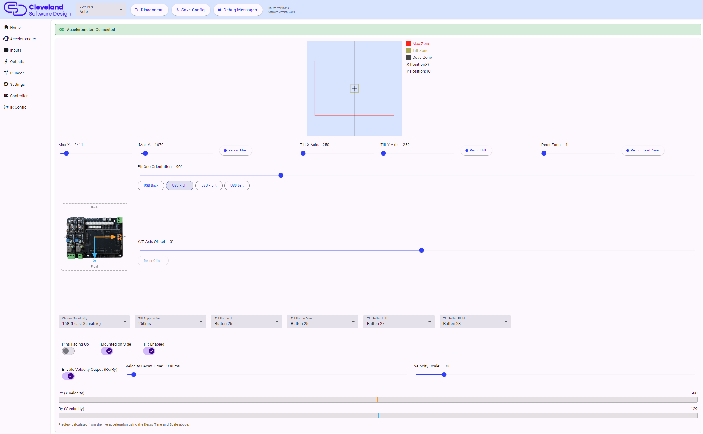

# Accelerometer

Configuring the accelerometer is fairly straight forward, but a good configuration can add a lot of realism to your pinball machine, while also preventing common issues. The PinOne Ultra uses a QMI8658 accelerometer that is detected when the board starts. The top of the page shows whether the accelerometer was found.

The graph at the top of the page shows the live position. The gray square is the dead zone, the yellow square is the tilt boundary and the outer square is the max value.

If the accelerometer shows as disabled, turn on `Accelerometer Enabled` in [Settings](./mainSettings#other-settings).

The first time you go to configure the accelerometer, I recommend performing the following steps:

### 1. Set the orientation

The orientation section shows the PinOne board as it sits in the cabinet, as seen from above. Use the **PinOne Orientation** slider to rotate the X axis (the blue line) in 5 degree steps until the board in the picture matches how the board is mounted in your cabinet. Quick pick buttons are available for the common angles. Moving the cabinet should now move the cursor in the graph in the same direction.

If the Y movement is off by a few degrees compared to X, use the **Y/Z Axis Offset** slider (the orange line) to fine tune it. Leave this at 0 unless you need it. The **Reset Offset** button puts it back to 0.

### 2. Set the "Pins Facing Up" and "Mounted on Side" switches

- **Pins Facing Up**: when mounted to a board with the pins facing down, leave this off. When the board is mounted by itself and the pins are facing upward, turn it on.
- **Mounted on Side**: turn this on if the board is mounted vertically, like it is on the PinOne Mini Machine. The Z axis is then used for movement. "Mounted on Side" only takes effect on the board once saved, so after changing it click `Save Config` to see the live position update.

### 3. Set the sensitivity

The **Choose Sensitivity** dropdown is the measurement range of the accelerometer chip. 2G is the most sensitive setting, where small nudges will make big impacts in the cursor. 16G is the least sensitive and can measure much harder impacts before clipping. You can then fine tune the feel using the max sliders.

### 4. Record the max value

Click **Record Max** and then nudge the cabinet as hard as you would expect during normal play, and then click **Stop Recording Max**. The Max X and Max Y sliders are set for you. If you want to make the accelerometer less sensitive to movement, increasing the max value is the best item to adjust. You can also set the sliders by hand.

### 5. Record the dead zone

Click **Record Dead Zone**, leave the cabinet still (and turn on any shaker or toys that would normally cause noise), then click **Stop Recording Dead Zone**. Any movement inside the dead zone is ignored. The dead zone is typically a small number. This can be helpful if toys like your shaker or solenoids are activating the accelerometer, and it also improves performance by only sending accelerometer events when they are actually happening.

### 6. Record the tilt value

Click **Record Tilt**, tilt the table to the point where you would consider a tilt event occurring and then click **Stop Recording Tilt**. This sets the Tilt X and Tilt Y sliders, which are shown as the yellow square on the graph. When tilt is reached the board presses the tilt button for that direction.

### 7. Set the tilt buttons

When **Tilt Enabled** is switched on, you can choose a different button for each of the four directions (up, down, left, right). This can be helpful if you want to use keyboard like nudging but still use the accelerometer to send the events. In VPX you might want to set the same button for all four directions. All four tilt buttons must be set when tilt is enabled, otherwise the tool shows a warning.

**Tilt Suppression** is how long tilt is ignored after the first tilt event, so the tilt button is not sent many times in a row. It is recommended to keep this above 200ms.

## Velocity Output

Some simulators, such as Visual Pinball with the "Analog Nudge Input is Velocity" option, work better with a nudge velocity than with raw acceleration. When **Enable Velocity Output (Rx/Ry)** is on, the PinOne Ultra additionally reports the calculated velocity of the cabinet on the Rx and Ry gamepad axes. The normal X/Y acceleration is still sent as before.

Only turn this on if your simulator supports velocity based nudge input and is configured to read Rx/Ry for it.

| Setting | Description |
|---|---|
| Velocity Decay Time | How long the velocity takes to decay to half its value when there is no new motion. Lower values recenter faster but may clip large slow nudges. Higher values feel smoother but drift more. |
| Velocity Scale | Scaling factor applied to the velocity before it is sent. Higher values make the output more sensitive. |

While velocity output is turned on, two bars show a live preview of the Rx and Ry output for the current decay time and scale, so you can tune the values without saving. The preview is calculated in the tool from live acceleration, so it is close to, but not exactly, what the board sends.

## Setting Tilt in VPX

In VPX, you need to configure the tilt to use a real tilt bob (even though the PinOne is simulated, it will work just as good as a real tilt bob) in order to do this, you need to take the following steps:

1. Navigate to your visual pinball scripts folder. Typically `C:\Visual Pinball\Scripts`
2. Find the file named `NudgePlugIn_mjrAccelAndTilt.vbs` and rename it to `NudgePlugIn.vbs` This will ensure that the tilt from the PinOne board does not cause a real tilt event on the table and also counts the tilt event properly towards a mechanical tilt.
