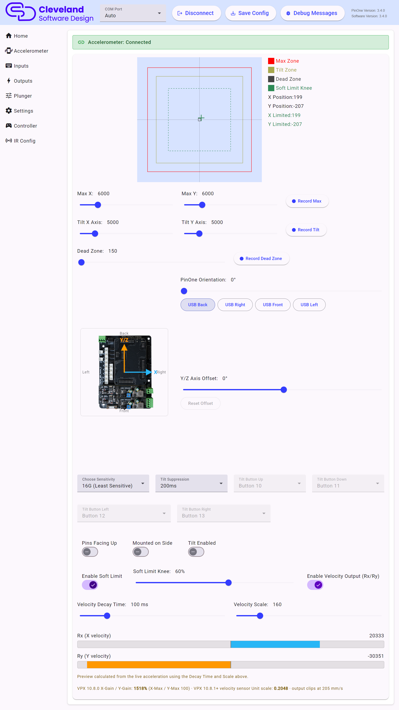

# Accelerometer

Configuring the accelerometer is fairly straight forward, but a good configuration can add a lot of realism to your pinball machine, while also preventing common issues. The PinOne Ultra uses a QMI8658 accelerometer that is detected when the board starts. The top of the page shows whether the accelerometer was found.

The graph at the top of the page shows the live position. The gray square is the dead zone, the yellow square is the tilt boundary and the outer square is the max value.

If the accelerometer shows as disabled, turn on `Accelerometer Enabled` in [Settings](./mainSettings#other-settings).

The first time you go to configure the accelerometer, I recommend performing the following steps:

### 1. Set the orientation

The orientation section shows the PinOne board as it sits in the cabinet, as seen from above. Use the **PinOne Orientation** slider to rotate the X axis (the blue line) in 5 degree steps until the board in the picture matches how the board is mounted in your cabinet. Quick pick buttons are available for the common angles. Moving the cabinet should now move the cursor in the graph in the same direction.

If the Y movement is off by a few degrees compared to X, use the **Y/Z Axis Offset** slider (the orange line) to fine tune it. Leave this at 0 unless you need it. The **Reset Offset** button puts it back to 0.

### 2. Set the "Pins Facing Up" and "Mounted on Side" switches

- **Pins Facing Up**: when mounted to a board with the pins facing down, leave this off. When the board is mounted by itself and the pins are facing upward, turn it on.
- **Mounted on Side**: turn this on if the board is mounted vertically, like it is on the PinOne Mini Machine. The Z axis is then used for movement. "Mounted on Side" only takes effect on the board once saved, so after changing it click `Save Config` to see the live position update.

### 3. Set the sensitivity

The **Choose Sensitivity** dropdown is the measurement range of the accelerometer chip. 2G is the most sensitive setting, where small nudges will make big impacts in the cursor. 16G is the least sensitive and can measure much harder impacts before clipping. You can then fine tune the feel using the max sliders.

### 4. Record the max value

Click **Record Max** and then nudge the cabinet as hard as you would expect during normal play, and then click **Stop Recording Max**. The Max X and Max Y sliders are set for you. If you want to make the accelerometer less sensitive to movement, increasing the max value is the best item to adjust. You can also set the sliders by hand.

### 5. Record the dead zone

Click **Record Dead Zone**, leave the cabinet still (and turn on any shaker or toys that would normally cause noise), then click **Stop Recording Dead Zone**. Any movement inside the dead zone is ignored. The dead zone is typically a small number. This can be helpful if toys like your shaker or solenoids are activating the accelerometer, and it also improves performance by only sending accelerometer events when they are actually happening.

### 6. Record the tilt value

Click **Record Tilt**, tilt the table to the point where you would consider a tilt event occurring and then click **Stop Recording Tilt**. This sets the Tilt X and Tilt Y sliders, which are shown as the yellow square on the graph. When tilt is reached the board presses the tilt button for that direction.

### 7. Set the tilt buttons

When **Tilt Enabled** is switched on, you can choose a different button for each of the four directions (up, down, left, right). This can be helpful if you want to use keyboard like nudging but still use the accelerometer to send the events. In VPX you might want to set the same button for all four directions. All four tilt buttons must be set when tilt is enabled, otherwise the tool shows a warning.

**Tilt Suppression** is how long tilt is ignored after the first tilt event, so the tilt button is not sent many times in a row. It is recommended to keep this above 200ms.

## Soft Limit

A real cabinet nudge is over in a fraction of a second, but an accelerometer reports a hard whack as a very large spike. Sent straight to the simulator, that can make the ball fly around far more than it would on a real table. The **soft limit** tames this: small and medium nudges are left alone, while harder hits are compressed, so it takes increasingly hard hits to push the ball further.

Turn on **Enable Soft Limit** to use it. It applies to the X/Y nudge axes and the tilt buttons. The velocity output is not soft limited: it always uses the full acceleration, so a harder nudge always gives a stronger velocity.

| Setting | Description |
|---|---|
| Soft Limit Knee | Where the compression starts, as a percentage of the Max value. Readings below the knee are sent unchanged. Above the knee the output flattens out and gets close to, but never reaches, the Max value. A lower knee limits the nudge earlier and more strongly. A higher knee leaves more of the range untouched. |

On the graph, the black crosshair is the raw reading from the accelerometer and the green crosshair is the value after the soft limit, which is what the board sends. The dashed green square is the knee. The two crosshairs sit on top of each other until a nudge goes past the knee. Both crosshairs and the X/Y Limited numbers update live as you change the setting, before you save.

The record buttons (Record Max, Record Tilt and Record Dead Zone) always use the raw reading, so the values they capture are not affected by the soft limit. Set the Max with **Record Max** first, because the knee is a percentage of it.

## Velocity Output

Some simulators, such as Visual Pinball with the "Analog Nudge Input is Velocity" option, work better with a nudge velocity than with raw acceleration. When **Enable Velocity Output (Rx/Ry)** is on, the PinOne Ultra additionally reports the calculated velocity of the cabinet on the Rx and Ry gamepad axes. The normal X/Y acceleration is still sent as before.

Only turn this on if your simulator supports velocity based nudge input and is configured to read Rx/Ry for it.

| Setting | Description |
|---|---|
| Velocity Decay Time | How long the velocity takes to decay to half its value when there is no new motion, from 10 to 500 ms (default 100 ms). Lower values recenter faster but may clip large slow nudges. Higher values feel smoother but drift more. The default of 100 ms works well, and there is rarely a reason to change it. |
| Velocity Scale | Axis units sent per mm/s of cabinet movement (default 160). This sets the units of the output, not how strong the nudge feels. Leave it at 160 and set the nudge strength in VPX instead (see below). Raising it makes the output max out at a lower speed, so every firm nudge ends up feeling the same. |

While velocity output is turned on, two bars show a live preview of the Rx and Ry output for the current decay time and scale, so you can tune the values without saving. The preview is calculated in the tool from live acceleration, so it is close to, but not exactly, what the board sends.

Below the bars, the tool shows the values to enter in VPX for the current Velocity Scale:

- **VPX 10.8.0 X-Gain / Y-Gain**: the gain that gives a real-world nudge strength in VPX 10.8.0.
- **VPX 10.8.1+ velocity sensor Unit scale**: the unit scale to use in VPX 10.8.1 and newer.
- **Output clips at**: the cabinet speed at which the output maxes out. Keep this above about 100 mm/s; at the default scale of 160 it is 205 mm/s.

## Setting up Velocity Nudge in VPX

How VPX reads the velocity depends on the version you are running. VPX 10.8.0 uses the **Keys, Nudge and DOF** dialog. VPX 10.8.1 and newer (which will become 10.9) set up nudge from the in-game settings menu instead. Follow the section for your version.

Before you start, turn on **Enable Velocity Output (Rx/Ry)** in the config tool, leave **Velocity Scale** at 160 and **Velocity Decay Time** at 100 ms, and click `Save Config`.

### VPX 10.8.0

In 10.8.0, the gain setting decides how much a given cabinet speed moves the ball. At 100% gain the whole axis only covers a very small speed range, so the gain has to be much higher than 100% for a velocity input. If the gain is left at 100%, nudges will barely register.

1. Open **Preferences > Configure Keys, Nudge and DOF**.
2. Under **Nudge, Plumb, Plunger > Axis Assignments**:
   - Set **X Axis (L/R)** to **rX Axis**.
   - Set **Y Axis (U/D)** to **rY Axis**.
   - Set **X-Max** and **Y-Max** to **100**.
   - Set **X-Gain** and **Y-Gain** to the value shown in the config tool. At the default Velocity Scale of 160 this is **1518**. The box accepts values over 100.
   - Set **Dead Zone** to **0**. The PinOne already applies its own dead zone.
3. Turn on **Enable Analog Nudge** and **Analog Nudge Input is Velocity**.
4. Click **OK**.

To adjust the strength, change **X-Gain** and **Y-Gain**: lower for gentler nudges, higher for stronger ones. Don't change the Velocity Scale in the config tool for this. If a nudge moves the ball the wrong way, tick **Reverse** for that axis.

The **Nudge Test and Calibration.vpx** table that comes with VPX is a good way to check the result.

### VPX 10.8.1 and newer

From 10.8.1, VPX expects the velocity in real units (m/s), and you set the strength separately.

1. Start a table and open the in-game settings menu, then go to **Nudge Settings**.
2. Under **Hardware sensor based nudge**, choose **Add a new nudge sensor**.
3. Set **Nudge Sensor Type**:
   - **Intent Sensor** turns each nudge into a clean push on the ball and ignores small cabinet wobble. This is a good starting point.
   - **Cabinet Sensor** passes the cabinet movement straight to the ball, which is more realistic. If you use it, set **Cabinet Weight** to the weight of your cabinet in kg.
4. Under **Side velocity sensor**:
   - Set **Hardware Sensor** to the PinOne's **Rx** axis.
   - Set **Sensor Type** to **Velocity**.
   - Set **Sensor unit** to **0.2048 m/s [Pinscape nudge velocity]**. This matches the PinOne exactly at the default Velocity Scale of 160. If you use a different scale, choose **Custom unit** and enter the **Unit scale** shown in the config tool.
5. Under **Front velocity sensor**, do the same with the PinOne's **Ry** axis.
6. Leave the **Side acceleration sensor** and **Front acceleration sensor** unmapped.
7. Start with **Nudge Strength** at **100%**.

To adjust the strength, change **Nudge Strength**, not the Velocity Scale in the config tool. If a nudge moves the ball the wrong way, turn on **Reversed axis** for that sensor. With **Intent Sensor**, a front nudge (pushing the cabinet away from you) needs to read as negative on the front axis, or VPX will ignore it. If front nudges do nothing, try turning on **Reversed axis** for the front sensor.

## Setting Tilt in VPX

In VPX, you need to configure the tilt to use a real tilt bob (even though the PinOne is simulated, it will work just as good as a real tilt bob) in order to do this, you need to take the following steps:

1. Navigate to your visual pinball scripts folder. Typically `C:\Visual Pinball\Scripts`
2. Find the file named `NudgePlugIn_mjrAccelAndTilt.vbs` and rename it to `NudgePlugIn.vbs` This will ensure that the tilt from the PinOne board does not cause a real tilt event on the table and also counts the tilt event properly towards a mechanical tilt.
