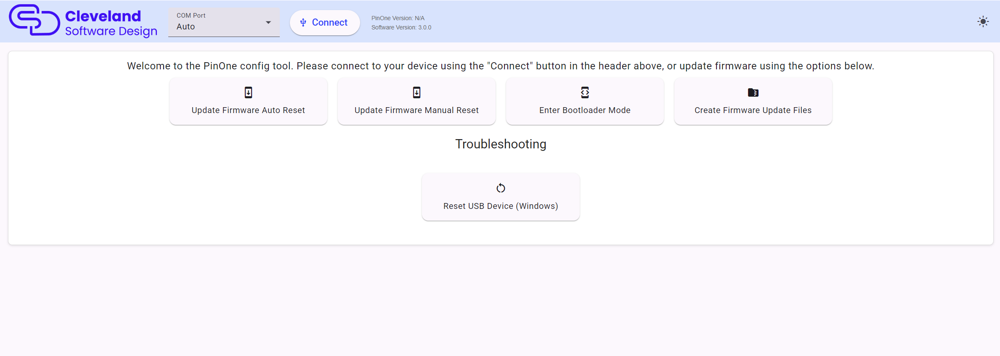
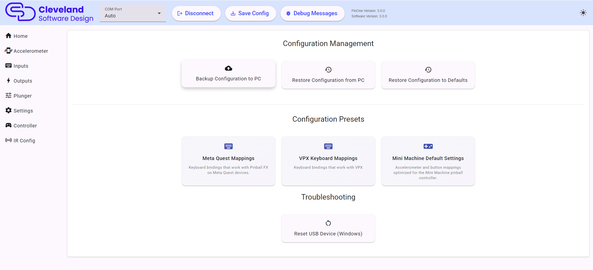

# PinOne Ultra Configuration Tool

### Download the config tool

On another platform? Download the [macOS (Intel)](https://github.com/philipellisis/PinOne/releases/download/v3.0.0/pinone-config-tool-3.0.0.dmg), [macOS (Apple Silicon)](https://github.com/philipellisis/PinOne/releases/download/v3.0.0/pinone-config-tool-3.0.0-arm64.dmg) or [Linux AppImage](https://github.com/philipellisis/PinOne/releases/download/v3.0.0/pinone-config-tool-3.0.0.AppImage) build, or see all files on the [releases page](https://github.com/philipellisis/PinOne/releases/tag/v3.0.0).

Configuring the PinOne Ultra is designed to be extremely simple. Just plug the board into your PC via a USB connection and run the configuration utility. Once running, click the `Connect` button in the header and you should see all the options appear in the side menu so you can easily test and configure the board.

### The header

The header at the top of the window is always visible and has the following controls:

- **COM Port**: leave this on `Auto` and the tool will find the PinOne for you. You only need to pick a port manually if you have more than one PinOne connected, or when updating firmware.
- **Connect / Disconnect**: connect to or disconnect from the board.
- **Save Config**: writes the current configuration to the board. Nothing you change in the tool is permanent until you click this button.
- **Debug Messages**: opens a panel that shows debug messages from the board. This is useful when troubleshooting, but see the note about the debug setting on the [settings page](./mainSettings#other-settings).
- **Version information**: shows the firmware version of the PinOne and the version of the config tool.
- **Theme toggle**: switches between the light and dark themes.

The PinOne Ultra communicates with the config tool over its USB HID channel, not over a virtual COM port, so a COM port is only needed for updating firmware.

### After Connecting

Once connected, the side menu lists all the pages available to test and configure the PinOne Ultra:

| Menu | What it does |
|---|---|
| Home | Backup, restore and presets |
| [Accelerometer](./accelerometer) | Nudge calibration, tilt, orientation and velocity output |
| [Inputs](./inputs) | Button labels, mapping, keyboard keys, debounce, input profiles and button lock |
| [Outputs](./outputs) | Test and configure all 63 outputs |
| [Plunger](./plunger) | Calibrate and tune the plunger |
| [Settings](./mainSettings) | Button triggers, night mode, light show and global options |
| [Controller](./steam) | Xbox style controller layout for Steam, and Bluetooth setup |
| [IR Config](./ir-settings) | Turn a TV on with the IR transmitter |

### Configuration Management

The home page has three cards for managing the whole configuration:

- **Backup Configuration to PC**: saves the current configuration to a file. In case you ever need to replace your PinOne board, having a backup of your configuration makes replacing it much easier.
- **Restore Configuration from PC**: loads a previously saved configuration file into the tool. Click `Save Config` to send it to the board.
- **Restore Configuration to Defaults**: loads the factory defaults into the tool. Click `Save Config` to send them to the board.

### Configuration Presets

Below the management cards are one click presets. A preset only changes the settings it needs, so it can be combined with your existing configuration. If you already have the plunger and accelerometer calibrated, applying the Meta Quest preset will not affect your calibration, it will only set the keyboard bindings and tilt buttons.

- **Meta Quest Mappings**: keyboard bindings that work with Pinball FX on Meta Quest devices. See [Meta Quest](../quest).
- **VPX Keyboard Mappings**: keyboard bindings that work with Visual Pinball.
- **Mini Machine Default Settings**: accelerometer and button mappings optimized for the PinOne Mini Machine.

As with every other change, click `Save Config` after applying a preset.

### Updating Firmware

Before you connect to the board, the home page shows four firmware options. This is not something you need to do on a newly purchased board as it should already have the latest firmware installed on it.

1. **Update Firmware Auto Reset**: the tool puts the ESP32-S3 into bootloader mode for you (by briefly opening the port at 1200 baud) and then uploads the firmware. This is the option to use first.
2. **Update Firmware Manual Reset**: put the board into bootloader mode yourself first, select its COM port in the header and then click this button to upload the firmware.
3. **Enter Bootloader Mode**: puts the board into bootloader mode and shows you the bootloader COM port once it is ready. Use this when you want to see which port the board will use before uploading.
4. **Create Firmware Update Files**: creates the firmware files and a script that you can run manually from the command line. This is useful for troubleshooting or for advanced users.

There is only one firmware for the PinOne Ultra. There is no separate X-Input firmware, because the PinOne Ultra works in Steam and VPX with no emulation and the config tool stays available at all times.

See [Issues updating firmware](../Troubleshooting/firmware) if you have trouble.

### Troubleshooting

The **Reset USB Device (Windows)** card on the home page removes the PinOne's USB device entries from Windows. Use it if the gamepad or keyboard buttons stop working correctly. Unplug the PinOne first, click the card, approve the administrator prompt, and then plug the PinOne back in. Windows will reinstall the device fresh.
