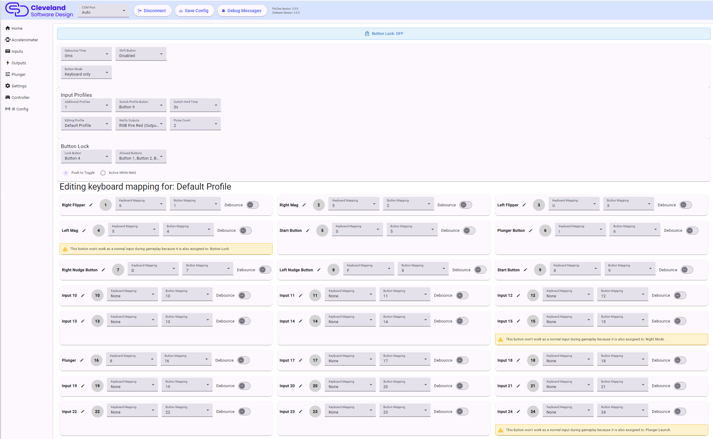

# Inputs

The inputs page shows all 32 inputs (the 24 physical buttons plus the 8 shifted buttons) as live indicators, so you can see exactly what the board sees when a button is pressed. Each input has its own card.

## Global input settings

### Debounce Time

How long a button will be ignored after it is pressed, to prevent multiple presses from being registered. This is the time used by any button that has its debounce toggle turned on. See [Debounce](#debounce).

### Shift Button

This dropdown selects which button is assigned as the "shift button". While this button is held, buttons 5-12 will trigger buttons 25-32 instead, allowing those buttons to have dual actions. Set it to `Disabled` to turn this feature off.

### Button Mode

Controls how a button press is sent to the computer:

- **Keyboard only**: buttons that have a keyboard key assigned in the active profile send only the keyboard key. Buttons with no key assigned fall back to sending the gamepad button.
- **Keyboard + Gamepad**: every press sends both the keyboard key and the gamepad button at the same time.

## Per input settings

### Button Labels

Each input can be renamed for convenience. Click the pencil icon next to the name to give the input a descriptive name such as "Left Flipper". The names are saved with the configuration and are also used on the [Controller page](./steam).

### Button Mapping

You can assign physical buttons to actuate different virtual buttons using the button mapping dropdown. For example if you want the button press on position 1 on the board to actually send an event to button 3, you can make that happen by setting the button mapping on input 1 to 3.

### Keyboard Mapping

Next to each button is a dropdown to select a keyboard key to send when the button is pressed. Whether the gamepad button is also sent depends on the Button Mode setting above. This is helpful for games that don't support a game controller or if you want to use a standard set of keys. The keyboard keys shown are for the profile selected in `Editing Profile` (see below).

### Debounce

Each input has a debounce toggle. When on, the input uses the global Debounce Time. This is not recommended for the flipper buttons, but can be helpful for some of the menu buttons to prevent accidentally double tapping them. Debounce is also useful on the plunger launch button, to hold the button down a little longer so the ball reliably launches in VPX.

### Conflict warnings

If an input is also used by another feature (the plunger launch button, a tilt button, night mode, the IR trigger or the button lock), the card shows a warning listing the other features. A button that is shared this way will not work as a normal input during gameplay, so assign each feature to its own button.

## Input Profiles

Input profiles let you keep up to four different sets of keyboard mappings on the board and switch between them using a button on the machine. For example you could have one profile for VPX and another for a front end or a different game. Only the keyboard mapping changes between profiles. Button mapping, debounce and everything else stay the same.

| Setting | Description |
|---|---|
| Additional Profiles | How many profiles there are in addition to the default one (0-3). Set to 0 to turn profile switching off. |
| Switch Profile Button | The button that cycles to the next profile. |
| Switch Hold Time | How long the switch button has to be held before the profile changes, from 0.5 to 10 seconds. `Immediate` switches as soon as the button is pressed. The default is 5 seconds. |
| Editing Profile | Which profile's keyboard mapping and notify outputs are displayed and edited below. This only affects what you see in the tool, it does not change the active profile on the board. |
| Notify Outputs | Up to 4 outputs that pulse when this profile becomes active. Pick an output that is easily noticed, such as a button light or a shaker. |
| Pulse Count | How many times the notify outputs pulse on and off (1-10) when this profile becomes active. |

The board always starts on the default profile when it powers on. Each profile can have its own notify outputs and pulse count, so that you can tell by feel or by light which profile you have switched to.

## Button Lock

The button lock is used to prevent accidental presses, for example when cleaning the cabinet, when children are playing or if the machine gets bumped. While the lock is on, every button is disabled except the allowed buttons.

| Setting | Description |
|---|---|
| Lock Button | The button that turns the lock on and off, or `Disabled` to turn the feature off. The lock button itself always works. |
| Allowed Buttons | The buttons that keep working while the lock is on. The default is buttons 1, 2, 3, 4, 9, 23 and 24 (typically the flippers, start and the nudge/tilt buttons). |
| Push to Toggle | Press the lock button once to lock, and press it again to unlock. |
| Active While Held | The lock is on only while the lock button is held down. |

The top of the inputs page shows a **Button Lock: ON / OFF** banner, and any button that is currently locked out shows a "Locked out" note on its card.
