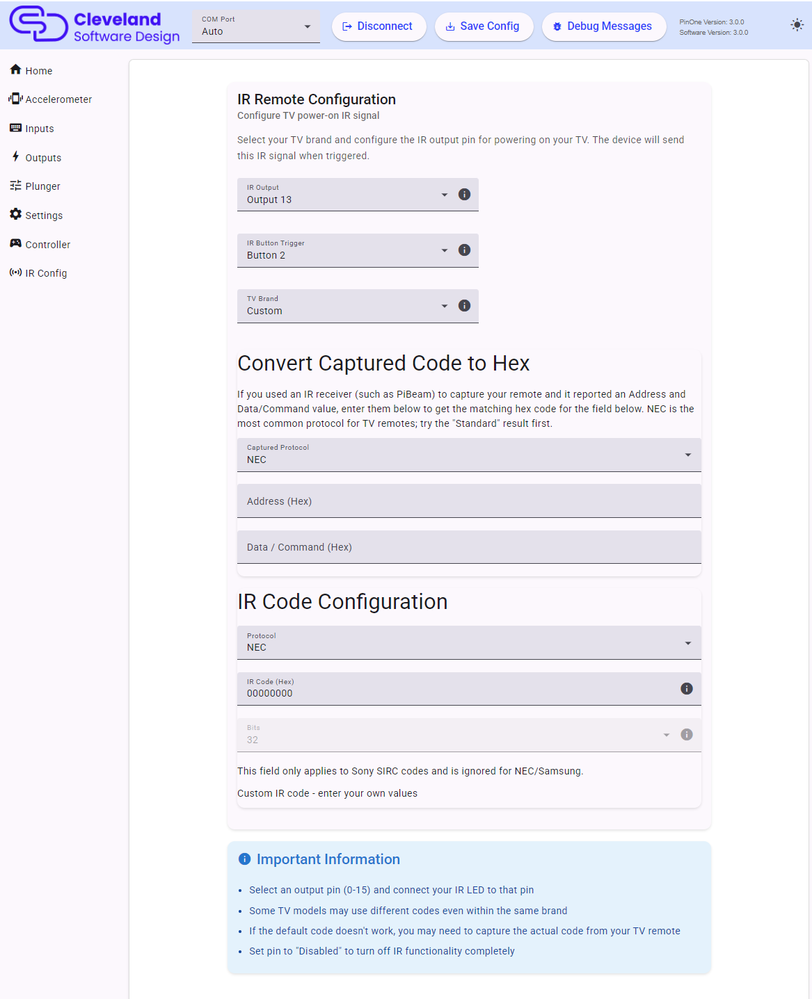

# IR Settings

The PinOne Ultra can send an infrared command, normally the TV power on command, when a button is pressed. It uses the board's hardware IR peripheral and supports the NEC, Samsung and Sony SIRC protocols.

## Setting IR functionality

1. **IR Output**: choose the output the IR LED is connected to, or `Disabled` to turn the IR feature off completely.
2. **IR Button Trigger**: choose the button that sends the command when pushed, or `Disabled`. If the button is also used by another feature (tilt, plunger launch or night mode) a warning is shown, since only one of the features will work.
3. **TV Brand**: choose your TV brand to load a predefined code. Some TV models use different codes even within the same brand, so if the default code doesn't work you may need to capture the real code from your remote.

You can only set one command to be sent, which is normally the power on event.

## IR Code Configuration

You can choose a brand from the predefined list or enter your own code:

| Field | Description |
|---|---|
| Protocol | None, NEC, Samsung or Sony SIRC. |
| IR Code (Hex) | The code to send in hex, without the `0x` prefix. |
| Bits | Only used by Sony SIRC, which sends a code of 12, 15 or 20 bits depending on the remote. NEC and Samsung always send a fixed 32-bit frame. |

## Convert Captured Code to Hex

If you used an IR receiver (such as PiBeam) to capture your remote and it reported an Address and a Data/Command value, enter them in this section to get the matching hex code:

1. Choose the captured protocol, NEC or Samsung.
2. Enter the Address and the Data/Command in hex.
3. For NEC, two results are shown. Try the **Standard (8-bit address)** result first, as most remotes use it. If it does not work, try the **Extended (16-bit address)** result.
4. Click **Use This Code** to copy the code and protocol into the IR Code Configuration above.

## Recommended IR LED

I have used the Adafruit IR emitter and it worked great: [Link to product](https://www.adafruit.com/product/5639)
