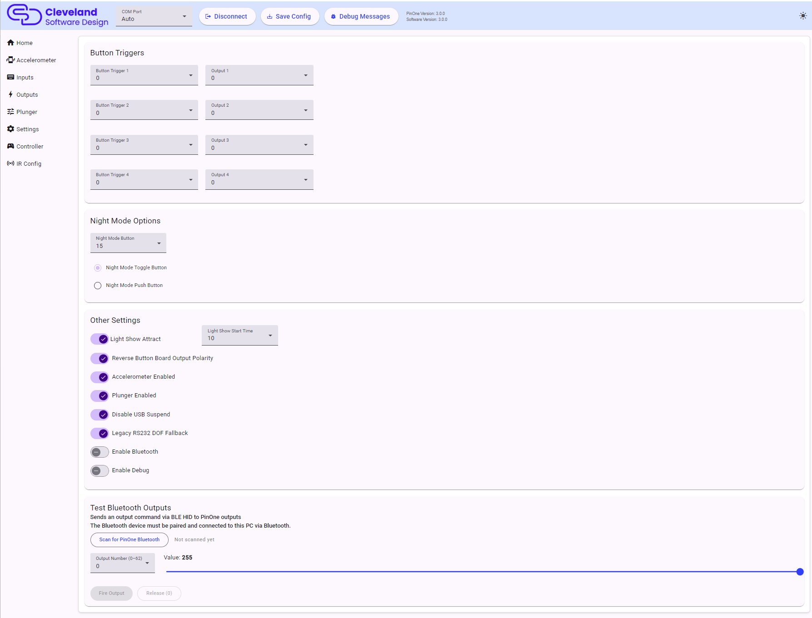

# Settings

## Button Triggers

This allows you to tie up to 4 buttons to an output on the PinOne board. This means that if a button is activated, it will then activate the output tied to it. This feature is most useful to easily bind flipper solenoids to the flipper buttons so you can have feedback even without having any DOF support. There are other uses for this as well however, as you could use a switch to turn something on or off in the cabinet. Outputs 1-63 can be selected.

## Night Mode Options

This section allows you to set which button will trigger night mode as well as what type of button you are using. If you are using a toggle button, then night mode will be activated while the button is "on" and disabled when the button is "off". If using a push button, when you push the button once, night mode will be activated, and pushing the button again will disable night mode. Choose `Disabled` to turn night mode off.

If the night mode button is also used by another feature, such as the plunger launch button or a tilt button, a warning is shown.

## Other Settings

This section is used to configure some additional global options on the PinOne board.

| Setting | Description |
|---|---|
| Light Show Attract | Turns the light show attract mode on or off. This is the pulsing of the lights on and off after a set period of inactivity. |
| Light Show Start Time | How many seconds of inactivity to wait before the light show starts. |
| Reverse Button Board Output Polarity | Should be turned on for all PinOne button boards to ensure proper operation of the button lights, but can be turned off in case you want to use those outputs for something else. |
| Accelerometer Enabled | Completely turns the accelerometer off. When off, the accelerometer page is hidden. |
| Plunger Enabled | Completely turns the plunger off. When off, the plunger page is hidden. |
| Disable USB Suspend | When on, the PinOne keeps running normally even if the computer suspends the USB device. Some motherboards do not fully support USB suspend, and it is better to turn this on if you have problems when the computer sleeps. |
| Legacy RS232 DOF Fallback | Keeps a legacy serial port active for DirectOutput installs that have not been updated for the PinOne Ultra's USB HID DOF protocol. Turn this off once your DOF install is updated, which avoids a small amount of extra serial polling. |
| Enable Bluetooth | Turns on Bluetooth LE so the PinOne can connect to a phone, tablet, PC or VR headset. |
| Enable Debug | Makes the PinOne send debug messages that are shown in the config tool's Debug Messages panel. This should never be left on during gameplay. |

## Test Bluetooth Outputs

The PinOne Ultra can receive output commands over Bluetooth LE as well as USB. This card lets you test that path from the config tool:

1. Pair the PinOne Ultra with your PC over Bluetooth first (see [Controller](./steam#bluetooth-le)).
2. Click **Scan for PinOne Bluetooth**. The status changes to "Connected" once the PinOne is found.
3. Pick an output number (0-62) and a value using the slider.
4. Click **Fire Output** to send the value to the output, and **Release (0)** to set it back to off.

The result of each command is shown below the buttons.

## Saving

Changes to any page do not take effect on the board until you click **Save Config** in the header.
