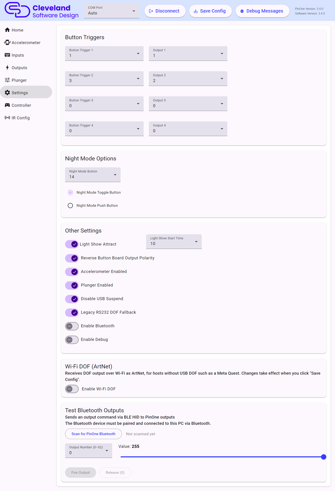
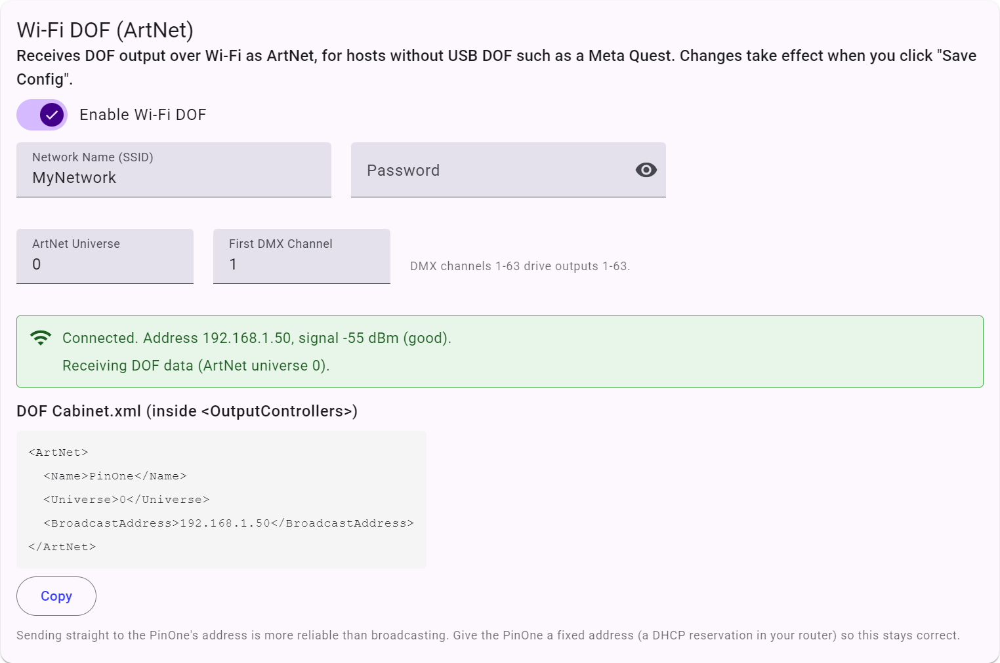

# Settings



## Button Triggers

This allows you to tie up to 4 buttons to an output on the PinOne board. This means that if a button is activated, it will then activate the output tied to it. This feature is most useful to easily bind flipper solenoids to the flipper buttons so you can have feedback even without having any DOF support. There are other uses for this as well however, as you could use a switch to turn something on or off in the cabinet. Outputs 1-63 can be selected.

## Night Mode Options

This section allows you to set which button will trigger night mode as well as what type of button you are using. If you are using a toggle button, then night mode will be activated while the button is "on" and disabled when the button is "off". If using a push button, when you push the button once, night mode will be activated, and pushing the button again will disable night mode. Choose `Disabled` to turn night mode off.

If the night mode button is also used by another feature, such as the plunger launch button or a tilt button, a warning is shown.

## Other Settings

This section is used to configure some additional global options on the PinOne board.

| Setting | Description |
|---|---|
| Light Show Attract | Turns the light show attract mode on or off. This is the pulsing of the lights on and off after a set period of inactivity. |
| Light Show Start Time | How many seconds of inactivity to wait before the light show starts. |
| Reverse Button Board Output Polarity | Should be turned on for all PinOne button boards to ensure proper operation of the button lights, but can be turned off in case you want to use those outputs for something else. |
| Accelerometer Enabled | Completely turns the accelerometer off. When off, the accelerometer page is hidden. |
| Plunger Enabled | Completely turns the plunger off. When off, the plunger page is hidden. |
| Disable USB Suspend | When on, the PinOne keeps running normally even if the computer suspends the USB device. Some motherboards do not fully support USB suspend, and it is better to turn this on if you have problems when the computer sleeps. |
| Legacy RS232 DOF Fallback | Keeps a legacy serial port active for DirectOutput installs that have not been updated for the PinOne Ultra's USB HID DOF protocol. This is no longer needed with DOF version 3.2.9763 or newer, so turn it off once you have installed the [latest DOF](../../DOF/installing.md), which avoids a small amount of extra serial polling. |
| Enable Bluetooth | Turns on Bluetooth LE so the PinOne can connect to a phone, tablet, PC or VR headset. |
| Enable Debug | Makes the PinOne send debug messages that are shown in the config tool's Debug Messages panel. This should never be left on during gameplay. |

## Wi-Fi DOF (ArtNet)



The PinOne Ultra can join your Wi-Fi network and receive DOF output as ArtNet. This is for hosts that can't send DOF over USB, such as a Meta Quest running a pinball app with DOF support. Wi-Fi DOF works alongside USB and Bluetooth, so you can leave it on.

1. Turn on **Enable Wi-Fi DOF**.
2. Enter your **Network Name (SSID)** and **Password**. The PinOne only supports 2.4 GHz networks, not 5 GHz. Leave the password blank for an open network.
3. Set the **ArtNet Universe** and **First DMX Channel** (see below). The defaults of universe 0 and channel 1 work for most setups.
4. Click `Save Config`. The PinOne then connects to the network.

| Setting | Description |
|---|---|
| Network Name (SSID) | The Wi-Fi network to join (up to 32 characters). |
| Password | The network password (up to 64 characters). The PinOne never sends a saved password back to the tool, so once it is saved the box is empty and shows "Saved (type to change)". Leaving it blank keeps the saved password, as long as the network name is unchanged. The password is never written to configuration backups. |
| ArtNet Universe | Must match the `Universe` of the ArtNet controller in your DOF `Cabinet.xml` (0-32767). |
| First DMX Channel | The DMX channel that drives output 1. The following channels drive outputs 2-63 (1-512). The tool shows which channels drive which outputs. |

### Wi-Fi status

While the settings page is open, the card shows the live Wi-Fi status reported by the PinOne. The status reflects the saved settings, so save the config before checking it.

| Status | Meaning |
|---|---|
| Connected. Address ..., signal ... dBm | The PinOne is on the network. A signal of -60 dBm or better is good, -70 dBm or worse is weak. |
| Receiving DOF data | ArtNet is arriving for the PinOne's universe. |
| No ArtNet received in the last few seconds | Nothing is sending DOF yet. Start a table with DOF to test. |
| ArtNet is arriving for universe X, but the PinOne listens on universe Y | Change the ArtNet Universe here or in `Cabinet.xml` so they match. |
| Network not found | Check the network name, and that it is a 2.4 GHz network. |
| The network refused the connection | Check the password. |

Bluetooth and Wi-Fi share one radio, which can add a little Wi-Fi latency. If Bluetooth is also on, test DOF timing before relying on it for solenoids.

### DOF Cabinet.xml

The card shows the ArtNet controller to add inside `<OutputControllers>` in your DOF `Cabinet.xml`, with a **Copy** button:

```xml
<ArtNet>
  <Name>PinOne</Name>
  <Universe>0</Universe>
  <BroadcastAddress>192.168.1.50</BroadcastAddress>
</ArtNet>
```

Once the PinOne is connected, the example uses its address. Sending straight to the PinOne's address is more reliable than broadcasting, so give the PinOne a fixed address (a DHCP reservation in your router) so that the address in `Cabinet.xml` stays correct. Until the PinOne is connected, the example broadcasts to every device on the network (`255.255.255.255`).

## Test Bluetooth Outputs

The PinOne Ultra can receive output commands over Bluetooth LE as well as USB. This card lets you test that path from the config tool:

1. Pair the PinOne Ultra with your PC over Bluetooth first (see [Controller](./steam#bluetooth-le)).
2. Click **Scan for PinOne Bluetooth**. The status changes to "Connected" once the PinOne is found.
3. Pick an output number (0-62) and a value using the slider.
4. Click **Fire Output** to send the value to the output, and **Release (0)** to set it back to off.

The result of each command is shown below the buttons.

## Saving

Changes to any page do not take effect on the board until you click **Save Config** in the header.
