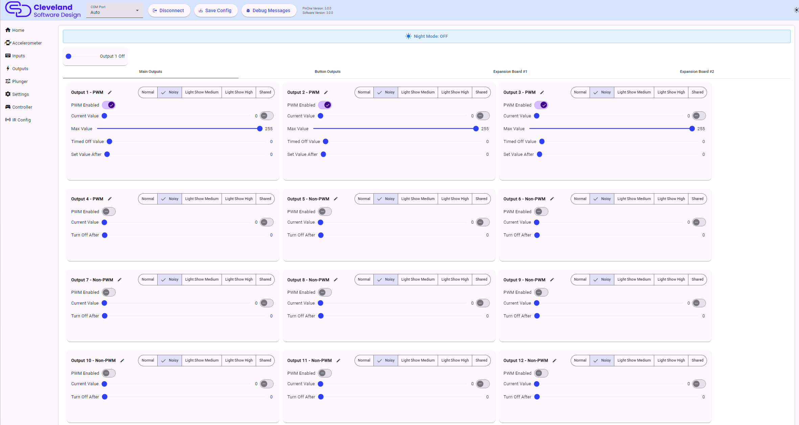

# Output Settings

The PinOne Ultra has 63 outputs. They are split across four tabs in the outputs page:

| Tab | Outputs | Hardware |
|---|---|---|
| Main Outputs | 1-15 | The 15 direct PWM outputs on the PinOne Ultra board |
| Button Outputs | 16-31 | First PCA9685 board (I2C address 0x40), normally the button light board |
| Expansion Board #1 | 32-47 | Second PCA9685 board (I2C address 0x41) |
| Expansion Board #2 | 48-63 | Third PCA9685 board (I2C address 0x42) |

The button, expansion #1 and expansion #2 tabs show whether their board was detected when the PinOne started, so you can tell right away if a board is not wired correctly.

## Master slider

The slider at the top of the page cycles through all the outputs in turn, which is a quick way to test that everything is wired up and working.

## Night Mode indicator

The banner at the top shows if night mode is currently on or off. When night mode is enabled, no outputs that are set as "Noisy" or "Shared" will turn on. The button that triggers night mode can be set in the [settings](./mainSettings#night-mode-options).

## Output names

Each output can be given a name, such as "Left Flipper" or "Shaker". Click the pencil icon next to the output number to rename it. The names are saved with the configuration and are used in other places in the tool, such as the output dropdowns on the settings and inputs pages.

## PWM Enabled

All 63 outputs can be used either as PWM (dimmable) outputs or as simple on/off outputs. Turn **PWM Enabled** on to allow the output to be dimmed, which is what you want for LEDs, motors and flasher brightness. Turn it off to use the output as an on/off switch only, which is what you want for solenoids, relays and contactors.

When PWM is turned off, the sliders below change to match: the "Max Value" and "Timed Off Value" sliders are hidden and the "Set Value After" slider becomes **Turn Off After**.

## Current Value

Use the slider to test the output at any PWM value from 0 to 255, or use the switch next to it to turn the output fully on or off. Note this value is only used for testing and does not change when you save the configuration.

## Max Value

This setting configures the absolute maximum output that will be allowed for the output, regardless of what output has been sent to the board. This will override any command given so the output will never go above this amount. This can be great for modifying the speed of a motor, or adjusting the brightness of lights. Sometimes this can also be adjusted in DOF, but it's much more convenient to set it here and just leave DOF to its default setting.

If the max value is set to 0 the output will never turn on, and the tool shows a warning. Do not lower this value for solenoids connected to life extenders, the tool warns about this too.

## Timed Off Value and Set Value After

The **Timed Off Value** is the value that the output will go to after the **Set Value After** time limit is reached. The time is shown in seconds, in steps of a tenth of a second up to about 25 seconds. This means that if the value is set to 255 initially, and you have the "Set Value After" set to 1 second, then after 1 second, the value will change to what you have set as the Timed Off Value. This is useful for assigning "flipper logic" to solenoids or preventing LED lights from being at full brightness for too long. If you are using the life extenders, then there is no need to set this, but it can be used to turn off a solenoid that might have been left on for too long to protect it in case you don't have life extenders installed.

For on/off outputs, **Turn Off After** simply turns the output off after the set time.

## Toy Category

Set this depending on the nature of the device. Below is a description of the different settings and how it affects the output:

 - **Normal** A normal output with no special considerations.
 - **Noisy** When night mode is enabled, the devices set to noisy will stop responding to events, thus preventing the cabinet from being noisy at night.
 - **Light Show Medium** That output will be part of the special "light show" that runs if no input or output is received by the device for a set period of time. This allows you to enjoy special effects with your lighted buttons and other lights in your setup even if you don't have DOF functioning. The "Medium" setting specifies that the lights will be at 50% intensity until a button press, which will then cause them to light up to max intensity until the button is released.
 - **Light Show High** Same as the above, only in this mode the lights will always be at 100% intensity, so pressing a button won't affect how bright it is.
 - **Shared** These outputs are also affected by night mode, but they will also share events. This is typically used with solenoids so if you have an event telling a solenoid to trigger, but that output is already enabled, it will look to other shared outputs to trigger instead.

## Controlling outputs over Bluetooth

DOF output commands can also arrive over Bluetooth LE when the PinOne Ultra is connected to a device over Bluetooth. You can test this from the [settings page](./mainSettings#test-bluetooth-outputs).

## How to set button colors

If you want your buttons to always light up to a certain color, you can do that by changing a couple of settings:

1. Set the Max Value to the number you want
2. Set the toy category to "Light Show High", this will ensure the button LED is always at maximum intensity.

When you click save and exit the menu, the buttons will turn off. The button colors will turn on to the set values once you exit the config tool and wait for the light show to start. The number of seconds before the light show turns on is configurable on the main settings menu, but is defaulted to 10 seconds.

Note that the secondary light show will still apply when the buttons are in "attract mode" (Attract mode can be disabled in the main settings menu) but as soon as you press a button, the colors will change to the setting defined.
