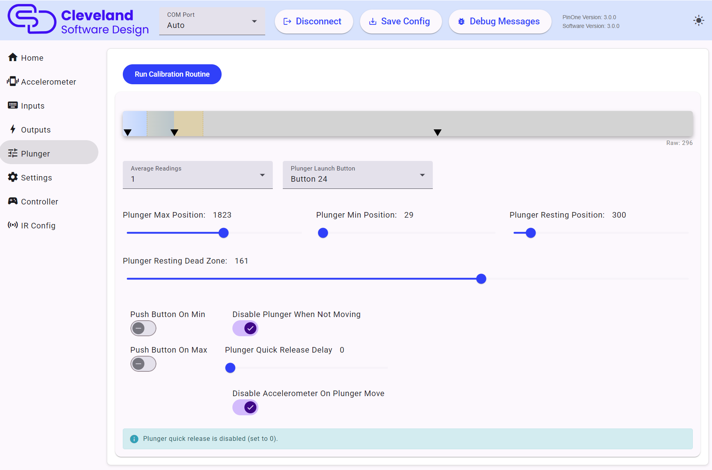
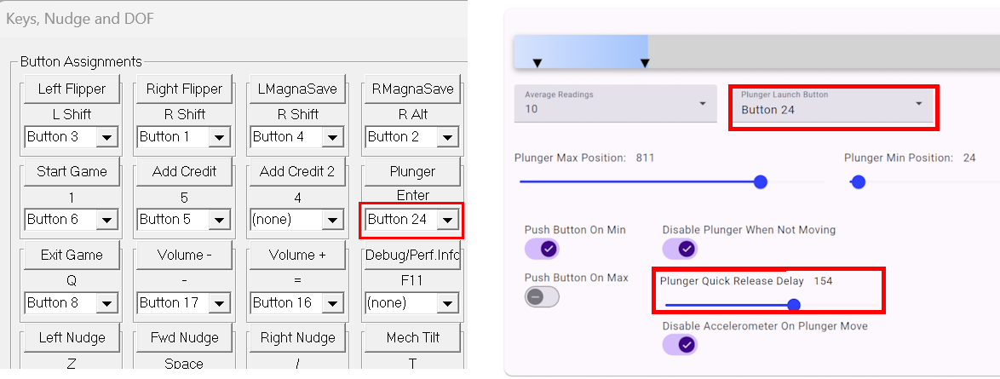

# Plunger

If the plunger shows as disabled, turn on `Plunger Enabled` in [Settings](./mainSettings#other-settings).

The PinOne Ultra reads the plunger with a 12-bit ADC and reports it in millivolts, so all the plunger values on this page are between 0 and 3300. Plunger calibrations from the original PinOne need to be redone on the PinOne Ultra.

## Calibrate

To calibrate your plunger, click **Run Calibration Routine**, push the plunger all the way forward and pull it all the way back a couple of times to set the minimum and maximum, then leave the plunger in the resting position and click **Finish Calibration**. The min, max and resting position sliders are set for you. Remember to click `Save Config` afterwards. Once set, you shouldn't need to redo the calibration unless you notice something not working properly.

The graph shows the live plunger position along with the min, resting and max positions and the resting dead zone.

## Position values

| Setting | Description |
|---|---|
| Plunger Max Position | The value when the plunger is pulled all the way out. |
| Plunger Min Position | The value when the plunger is pushed all the way in. Keep this at least 64 mV below the resting position. |
| Plunger Resting Position | Where the plunger sits when it is not being touched. |
| Plunger Resting Dead Zone | How far from the resting position the plunger must move before it is treated as moving. A larger value means the plunger has to move further before it is detected. |

If the min, resting and max values are too close together (160 mV or less) the tool shows a warning and you should re-run the calibration.

## Set to auto push the "Launch Ball" button

The **Plunger Launch Button** dropdown selects the button that the plunger can press. The "Push Button On Min" and "Push Button On Max" switches push that button whenever the plunger gets close to the min value, the max value, or both. This allows you to auto launch the ball in games that don't support the plunger or use the plunger to push a button when pressed in all the way. The disadvantage of pushing the button "on max" is that when you pull the plunger all the way back, it will push the launch button. In games that support the plunger it will release the plunger and shoot the ball if you move the plunger all the way back and then forward again. This is normally not a big deal but something to be aware of. This feature is really nice when you have kids playing pinball who just want to pull the plunger and still want the ball to shoot on all games. It still allows for the skill shot feature to be used, but you are not going to be able to move the plunger slowly back to start once you pull it all the way back.

If the launch button is also used by another feature, such as tilt, night mode or the IR trigger, the tool shows a warning.

## Average Readings

Sets how many readings are averaged to smooth the plunger position before it is sent. Around 5-10 is usually enough. Values above 10 can make the plunger lag, particularly when quick release is on, and the tool shows a warning. Note that the position graph shows the raw readings from the plunger before averaging.

## Disable Plunger When Not Moving

This setting will ignore small plunger movements when the plunger isn't actively moving and is in its resting position. This can improve latency by a small amount when actively playing a game and using the flippers, but in systems where there is excessive noise in the USB ground, it could cause the plunger to unexpectedly move during gameplay which can be distracting and disable the accelerometer if that setting is enabled. If you experience this, then it is recommended to turn this off and instead rely on the plunger average readings to stabilize the plunger.

## Plunger Quick Release Delay

This setting will cause the plunger to immediately move from the held position to the minimum position when released. Quick release is on when the delay is greater than 0, and should be set to approximately 150ms for accurate VPX plunger release. Values from 1-25 are too low to work reliably and the tool shows a warning. When turning this on, you also need to ensure the `Plunger button` in VPX is set to the same button that is set as the `Plunger Launch Button` in the config tool:

Quick release adds a slight delay while moving the plunger, so keep the average readings at 10 or below when using it.

## Disable Accelerometer on Plunger Move

This setting will disable the accelerometer when the plunger is not at the resting position. This can be helpful if releasing the plunger causes the ball to change movement due to the accelerometer being triggered, especially in a small cabinet. If the plunger actual position is not near the resting position, the tool will warn that the accelerometer will be disabled and that calibration might need to be redone.
