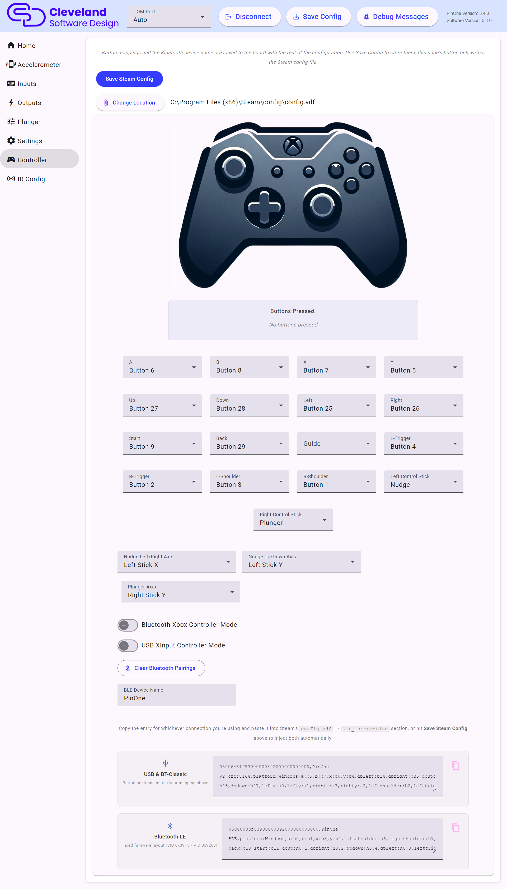
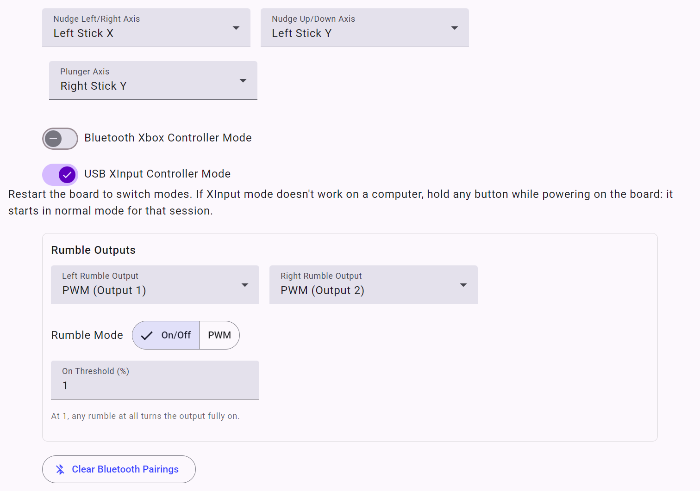

# Controller (Steam, Xbox and Bluetooth)

The Controller page, which was called "Steam" in earlier versions of the tool, is where you map the PinOne's buttons to a standard Xbox controller. The same mapping is used for Steam, for Bluetooth, and for the USB XInput controller mode.

## Mapping buttons to the controller

The picture of the Xbox controller highlights the control you are hovering over. Use the dropdowns to assign one of the PinOne's buttons to each Xbox button (A, B, X, Y, the bumpers, triggers, D-pad, Start, Back, etc.), and to choose whether the left and right control sticks are the `Plunger` or the `Nudge`.

The **Buttons Pressed** indicator shows the buttons that are being pressed on the PinOne right now. A button that is not mapped to any Xbox control is shown with a different color, which makes it easy to find buttons you have forgotten to assign.

## Xbox controller settings

### Stick axes

The **Nudge Left/Right Axis**, **Nudge Up/Down Axis** and **Plunger Axis** dropdowns choose which Xbox stick axis (Left Stick X/Y or Right Stick X/Y) the accelerometer nudge and the plunger are sent on. These are used over Bluetooth (in both Bluetooth modes) and in USB XInput mode. The defaults put the nudge on the left stick and the plunger on the right stick Y axis.

Each signal needs its own axis. If two of them are set to the same axis, the tool shows an error, because only one of them would work.

The axes used by the normal USB gamepad are set separately, on the [Inputs page](./inputs#gamepad-axes).

### Bluetooth Xbox Controller Mode

Normally the PinOne Ultra connects over Bluetooth as a combined gamepad, keyboard and DOF device. With **Bluetooth Xbox Controller Mode** turned on, it connects as a stock Xbox Series X controller instead. Use this for devices and games that only accept a real Xbox controller.

In this mode:

- Only the gamepad is sent over Bluetooth. Keyboard keys and Bluetooth DOF are not available.
- The host's rumble commands drive the outputs chosen under [Rumble Outputs](#rumble-outputs).
- Steam recognizes the controller on its own, so the Bluetooth LE Steam entry and the BLE Device Name are hidden.

The change takes effect after the board restarts. Remove the old PinOne pairing from your device's Bluetooth list first, then pair again.

### USB XInput Controller Mode

With **USB XInput Controller Mode** turned on, the PinOne Ultra connects over USB as an Xbox 360 (XInput) controller instead of the PinOne joystick. It uses the button mapping, stick axes and rumble outputs from this page. The keyboard, DOF and the config tool all keep working.

Use this for games that only support XInput controllers. For VPX and Steam the normal mode is still recommended, as it does not need any emulation.

The change takes effect after the board restarts. If XInput mode doesn't work on a computer, hold any button while powering on the board: it starts in normal mode for that session, so you can connect the config tool and turn XInput mode off.

### Rumble Outputs

When Bluetooth Xbox Controller Mode or USB XInput Controller Mode is on, the game's rumble can drive outputs on the PinOne, for example a shaker motor or a solenoid.

| Setting | Description |
|---|---|
| Left Rumble Output | The output driven by the controller's left (strong, low frequency) rumble motor, or `None`. |
| Right Rumble Output | The output driven by the controller's right (weak, high frequency) rumble motor, or `None`. If both motors use the same output, it follows whichever motor is stronger. |
| Rumble Mode | **On/Off**: the output switches fully on once the rumble strength reaches the threshold. **PWM**: the output level follows the rumble strength. |
| On Threshold (%) | On/Off mode only. The rumble strength (1-100%) at which the output turns fully on. At 1, any rumble at all turns the output on. |

:::warning
Solenoid life extenders (the max on time of an output) don't work in PWM mode, because each change in rumble strength restarts the timer and a solenoid could be held on indefinitely. Use On/Off mode for solenoids, contactors and other coils.
:::

In PWM mode the output also needs to have **PWM Enabled** on the [Outputs page](./outputs#pwm-enabled). If it is set to on/off only there, it still switches fully on at any rumble, and the tool shows a warning.

### Clear Bluetooth Pairings

**Clear Bluetooth Pairings** makes the board forget every paired Bluetooth device. Use it if a device pairs but doesn't work, or won't connect after being re-paired. Afterwards, remove the PinOne from the Bluetooth list on each device and pair again.

## Saving to Steam

Once you have set up the controller the way you like, click **Save Steam Config** to write the configuration straight into your Steam `config.vdf` file, so there is no need to do any calibration in Steam at all. Steam must be fully shut down for this to work. If the file is in a non-standard location, use **Change Location** to pick the `.vdf` file yourself.

The page also generates the configuration text so you can paste it into Steam yourself. There is one entry for each way of connecting:

- **USB & BT-Classic**: the button positions match the mapping you set above, and the stick axes follow the USB axis assignments on the [Inputs page](./inputs#gamepad-axes).
- **Bluetooth LE**: a fixed layout used for the Bluetooth LE connection, where the D-pad is a hat switch and the triggers are axes. This entry is not shown in Bluetooth Xbox Controller Mode, because Steam already knows the Xbox controller.

Click the copy icon next to the entry that you use, and paste it into the `SDL_GamepadBind` section of Steam's `config.vdf`, or into the Steam controller calibration screen. Using **Save Steam Config** injects both entries automatically. See [Steam Calibration](../steam-calibration) for more details.

## Bluetooth LE

The PinOne Ultra has Bluetooth LE built in, there is no separate Bluetooth module. It appears to the computer or device as an Xbox style gamepad together with a keyboard, and it can also receive DOF output over Bluetooth.

1. Turn on **Enable Bluetooth** in [Settings](./mainSettings#other-settings) and click `Save Config`.
2. Pair the PinOne Ultra with your device using its Bluetooth settings.

The mapping you set on this page is also the mapping used for the Bluetooth gamepad. A button mapped to an Xbox control is sent as that Xbox control over Bluetooth, which is why it is configured here along with the Steam mapping.

### BLE Device Name

The **BLE Device Name** is the name that the PinOne advertises over Bluetooth (up to 31 characters). Change this if you have more than one PinOne, or if you want something more descriptive. The new name takes effect after the board restarts. It is hidden in Bluetooth Xbox Controller Mode, where the board always appears as an Xbox controller.

The Bluetooth button mapping, device name, stick axes, controller modes and rumble settings are saved to the board with the rest of the configuration, so you need to click **Save Config** in the header. The `Save Steam Config` button on this page only writes the Steam file.
