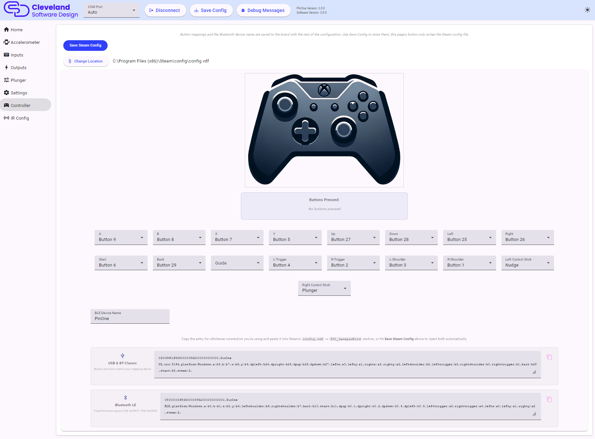

# Controller (Steam and Bluetooth)

The Controller page, which was called "Steam" in earlier versions of the tool, is where you map the PinOne's buttons to a standard Xbox controller for Steam and for Bluetooth.

## Mapping buttons to the controller

The picture of the Xbox controller highlights the control you are hovering over. Use the dropdowns to assign one of the PinOne's buttons to each Xbox button (A, B, X, Y, the bumpers, triggers, D-pad, Start, Back, etc.), and to choose whether the left and right control sticks are the `Plunger` or the `Nudge`.

The **Buttons Pressed** indicator shows the buttons that are being pressed on the PinOne right now. A button that is not mapped to any Xbox control is shown with a different color, which makes it easy to find buttons you have forgotten to assign.

## Saving to Steam

Once you have set up the controller the way you like, click **Save Steam Config** to write the configuration straight into your Steam `config.vdf` file, so there is no need to do any calibration in Steam at all. Steam must be fully shut down for this to work. If the file is in a non-standard location, use **Change Location** to pick the `.vdf` file yourself.

The page also generates the configuration text so you can paste it into Steam yourself. There is one entry for each way of connecting:

- **USB & BT-Classic**: the button positions match the mapping you set above.
- **Bluetooth LE**: a fixed layout used for the Bluetooth LE connection, where the D-pad is a hat switch and the triggers are axes.

Click the copy icon next to the entry that you use, and paste it into the `SDL_GamepadBind` section of Steam's `config.vdf`, or into the Steam controller calibration screen. Using **Save Steam Config** injects both entries automatically. See [Steam Calibration](../steam-calibration) for more details.

## Bluetooth LE

The PinOne Ultra has Bluetooth LE built in, there is no separate Bluetooth module. It appears to the computer or device as an Xbox style gamepad together with a keyboard, and it can also receive DOF output over Bluetooth.

1. Turn on **Enable Bluetooth** in [Settings](./mainSettings#other-settings) and click `Save Config`.
2. Pair the PinOne Ultra with your device using its Bluetooth settings.

The mapping you set on this page is also the mapping used for the Bluetooth gamepad. A button mapped to an Xbox control is sent as that Xbox control over Bluetooth, which is why it is configured here along with the Steam mapping.

### BLE Device Name

The **BLE Device Name** is the name that the PinOne advertises over Bluetooth (up to 31 characters). Change this if you have more than one PinOne, or if you want something more descriptive. The new name takes effect after the board restarts.

The Bluetooth button mapping and device name are saved to the board with the rest of the configuration, so you need to click **Save Config** in the header. The `Save Steam Config` button on this page only writes the Steam file.
