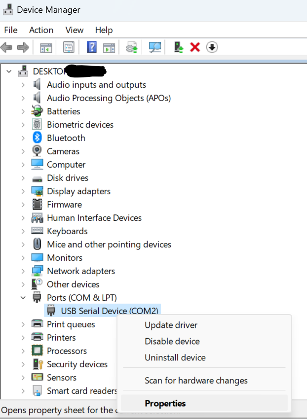
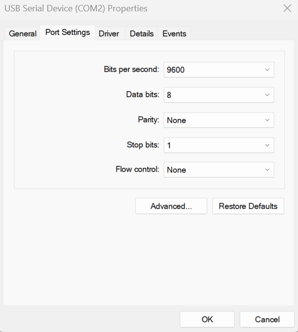

# Issues updating firmware

The PinOne Ultra is updated from the home page of the config tool, before you connect to the board. If `Update Firmware Auto Reset` does not work, work through the options below in order.

## Option 1: Enter bootloader mode from the config tool

1. In the config tool header, select the COM port of the PinOne.
2. Click `Enter Bootloader Mode`. The tool opens the port at 1200 baud, which makes the ESP32-S3 restart into its bootloader, and then shows you the bootloader COM port.
3. Select the bootloader COM port in the header and click `Update Firmware Manual Reset`.

## Option 2: Put the board into bootloader mode by hand

If the board does not respond to the above (for example if the firmware on it is not running):

1. Check the COM ports that are available in the dropdown and make note of them.
2. Hold down the `BOOT` button on the board, press and release the `RESET` button, and then release `BOOT`. The board is now in bootloader mode. If your board has no buttons, unplug USB, hold `BOOT`, and plug it back in.
3. A new COM port appears in the dropdown. Select it and click `Update Firmware Manual Reset`.
4. Once the firmware is installed, press the reset button or unplug and plug in the USB cable again.

## Option 3: Create the firmware files and flash from the command line

Click `Create Firmware Update Files` to have the tool create the firmware files and a script that you can run yourself from the command line. This is useful to see the exact error message if the update keeps failing.

## Re-assign the COM port in Windows

If Windows has a COM port number that is stuck or in use, go to device manager and find the device for the COM port, right click on the COM port and select "properties"

Next, navigate to the "port settings" tab and click "advanced"

Finally, re-assign a new, unused COM port, unplug the PinOne, restart the Config Tool software, and try updating the firmware again. See also [Com Port Issues](./com-ports).
