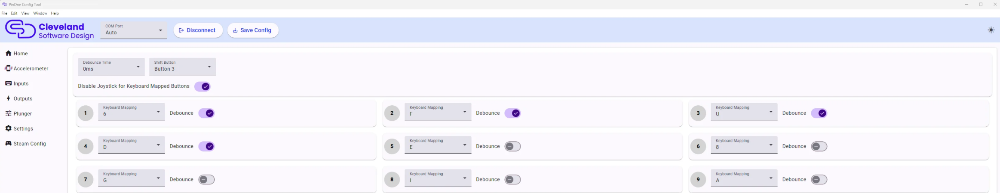

# Meta Quest VR

To use the PinOne Ultra with the Meta Quest 3 VR headset, the quickest way is to open the config tool home page and click the **Meta Quest Mappings** preset, then click `Save Config`. The preset only sets the keyboard bindings below and the tilt buttons, so it will not affect your plunger or accelerometer calibration. You can also map the buttons as keyboard inputs yourself on the [Inputs page](./Configuring/inputs):

A: Nudge Up

S: Nudge Down

D: Nudge Right

F: Nudge Left

U: Left Flipper

6: Right Flipper

I: Pause

8: Launch Ball

5: Powerup

Special thanks to DR_HVAC for finding this solution. You can find his post and give him an upvote here: https://www.reddit.com/r/virtualpinball/comments/1l20y2z/success_pinball_fx_vr_with_pinone_mini/