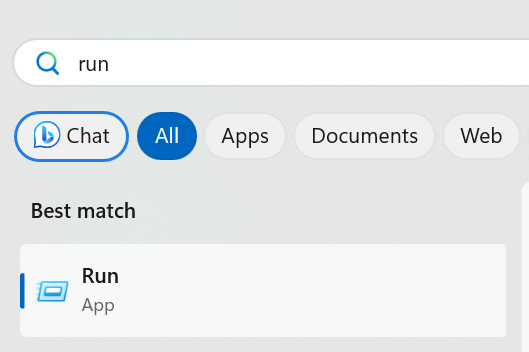
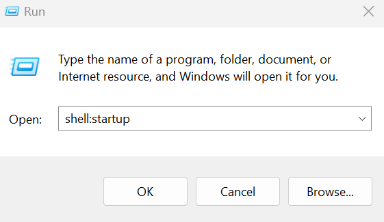
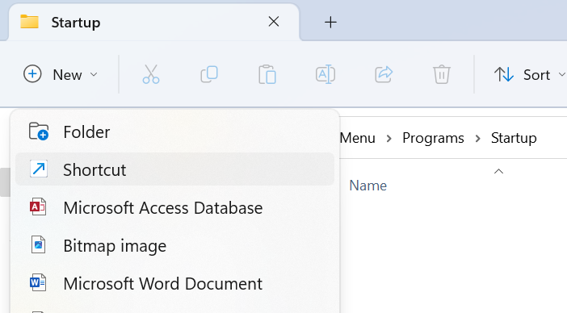

# Getting Started

Getting SuperDOF running only takes a few steps: download it, run the setup command, add your DOF config files, and set it to start with Windows.

:::note
SuperDOF replaces DOF and DOFLinx, so you do not need to install either of them. If you already have DOFLinx set to start with Windows, remove it from your startup folder so the two programs are not running at the same time.
:::

## 1. Download SuperDOF

1. Create a folder for SuperDOF, for example `C:\SuperDOF`.
2. Download both files and save them into that folder:
   - [superdof.exe](https://github.com/philipellisis/superdof/releases/latest/download/superdof.exe)
   - [superdof-console.exe](https://github.com/philipellisis/superdof/releases/latest/download/superdof-console.exe)

You can also find them on the [releases page](https://github.com/philipellisis/superdof/releases/tag/v0.7.2). `superdof.exe` is the version that runs in the background, and `superdof-console.exe` is the same program with a window, which you use for the setup command and for testing.

If Windows SmartScreen warns you when you first run them, click `More info` and then `Run anyway`.

## 2. Run the setup command

1. Hit the Windows key, search for `cmd`, right click on **Command Prompt** and select **Run as administrator**. Administrator rights are only needed this one time, so setup can write into the game folders in Program Files.
2. Run the following commands:

```
cd C:\SuperDOF
superdof-console setup
```

Setup automatically finds Visual Pinball, Pinball FX, Pinball M, Future Pinball and PinUP Popper, and installs what each of them needs. It prints what it found and what it installed, and finishes with `done: start superdof and leave it running`.

:::tip Pinball FX / Pinball M
Once SuperDOF is running, start the game, open **Settings > Cabinet**, turn on cabinet mode, and enable the **DOFLinx** option.
:::

## 3. Add your DOF config files

SuperDOF uses the same config files as DOF. Follow the steps in [Configuring DOF](../DOF/configuring) to create your config in the DOF Config tool and download it. Then, instead of copying the files to `C:\DirectOutput\config`, copy all of the `directoutputconfig` ini files into your `C:\SuperDOF` folder.

### Pinball FX and Pinball M table files

For these games, SuperDOF uses the table files that come with DOFLinx. Download the zip from [DOFLinx Files](https://github.com/DOFLinx/DOFLinx/releases), unzip it, and copy the `FX` and `Linx` folders into your `C:\SuperDOF` folder. You don't need anything else from the DOFLinx download, and this step is not needed if you do not care about the backglass features.

## 4. Add a cabinet.xml file (addressable LEDs only)

If you are using addressable LEDs, use the [Cabinet File Generator](../AddressableLED/cabinetGenerator) to create your `cabinet.xml`, and save it into your `C:\SuperDOF` folder. Make sure your DOF config also has the addressable LED outputs set up, as described in the [Addressable LED Config File](../DOF/configuring#addressable-led-config-file) section.

If you are not using addressable LEDs, skip this step.

Your `C:\SuperDOF` folder should now contain:
- `superdof.exe` and `superdof-console.exe`
- your `directoutputconfig` ini files
- the `FX` and `Linx` folders (if you play Pinball FX or Pinball M)
- `cabinet.xml` (if you use addressable LEDs)

## 5. Test it

In the command prompt, run:

```
cd C:\SuperDOF
superdof-console
```

Leave the window open and start a table. You should get feedback on your PinOne, and the window shows what SuperDOF is doing. Press `Ctrl+C` to stop it when you are done testing.

## 6. Set SuperDOF to start automatically

SuperDOF needs to be running for feedback to work, so set it to start with Windows:

1. Hit the Windows key, search for `run` and hit `enter`.


2. When the run dialog shows up, type in `shell:startup` and hit `ok`.


3. Inside the startup folder, right click and select **New > Shortcut**.


4. Browse to `C:\SuperDOF\superdof.exe` (not `superdof-console.exe`), click `Next`, then `Finish`.

Now SuperDOF starts every time you start your computer. It runs in the background with no window. To start it now without restarting, just double click the new shortcut.

:::tip PinOne Ultra users
SuperDOF talks to the PinOne Ultra directly over USB HID, so you can turn off **Legacy RS232 DOF Fallback** in the [config tool settings](../PinOneUltra/Configuring/mainSettings#other-settings).
:::

## Troubleshooting

- **No feedback at all**: run `superdof-console devices` in a command prompt to check that SuperDOF can see your PinOne.
- **Checking what happened**: when SuperDOF runs in the background, it writes a log to `C:\ProgramData\SuperDOF\superdof.log`.
- **Going back to DOF**: run `superdof-console restore-vpx` and `superdof-console restore-popper` from the `C:\SuperDOF` folder, remove the SuperDOF shortcut from your startup folder, and then follow the normal [DOF](../DOF/installing) and [DOFLinx](../DOFLinx/installing) installation steps.
